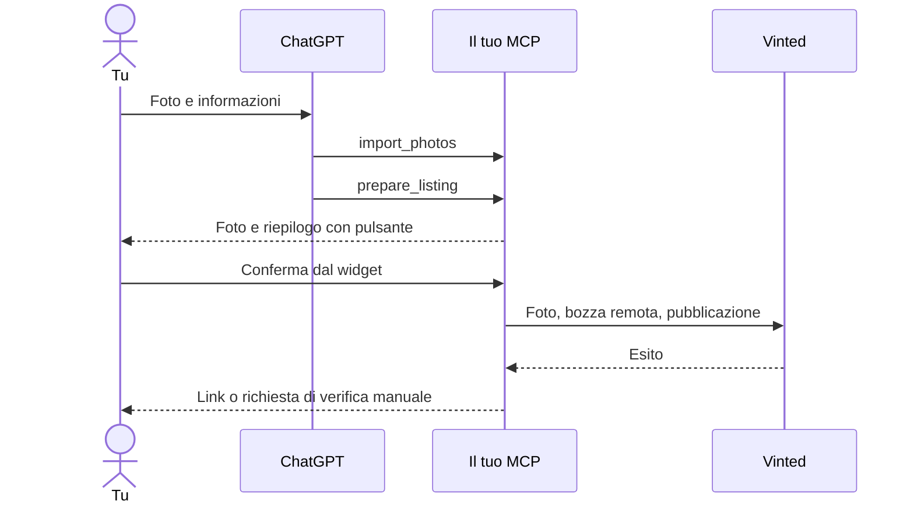

# Personal Vinted MCP

Server MCP personale e self-hosted per preparare un annuncio da foto in ChatGPT,
rivedere il riepilogo e pubblicarlo con un pulsante. Progetto indipendente,
non affiliato a Vinted. Licenza Apache-2.0.

**Stato: MVP sperimentale.** Flusso MCP, widget, OAuth e persistenza sono implementati
e testabili in simulazione. L'adattatore web per account normali è implementato ma
**non validato su un account reale**. Gli endpoint privati possono cambiare o rifiutare
le richieste. Non c'è garanzia di pubblicazione su qualsiasi account o di assenza di ban.

Vinted vieta strumenti esterni non autorizzati nei suoi [termini](https://www.vinted.com/terms-and-conditions).
La documentazione pubblica trovata per pubblicare annunci è quella delle
[integrazioni Pro](https://pro-docs.svc.vinted.com/): non dimostra che un normale account
abbia accesso a un'API ufficiale di pubblicazione. Per minimizzare il rischio di restrizioni,
richiedi autorizzazione a Vinted o pubblica manualmente il testo preparato.
Questo progetto non implementa occultamento del bot, imitazione di fingerprint,
rotazione di proxy o risoluzione di CAPTCHA. Si ferma ai rifiuti del servizio.

## Flusso

1. Alleghi le foto a ChatGPT e chiedi di usare la tua app Vinted MCP.
2. ChatGPT propone titolo, descrizione e prezzo; ti chiede ciò che non può verificare.
3. Il server importa gli allegati e salva una bozza locale senza inviare nulla a Vinted.
4. Un riquadro mostra foto, prezzo, categoria, marca, taglia, condizioni e pacco.
5. Premi **Conferma e pubblica**: solo allora parte l'invio a Vinted.
6. Ricevi l'esito e, se confermato dall'API, il link. Gestisci il resto su Vinted.

In modalità `mock` il pulsante dice **Conferma simulazione** e non contatta Vinted.
Il prezzo è una proposta del modello, non una quotazione basata su confronti di mercato.
Non serve una chiave OpenAI: la preparazione è svolta da ChatGPT.



## Installazione locale

Python 3.12+ e [uv](https://docs.astral.sh/uv/).

```powershell
uv sync --extra dev --locked
uv run vinted-mcp stdio
```

`stdio` serve ai client locali. ChatGPT remoto richiede HTTP raggiungibile tramite
HTTPS; non può raggiungere direttamente il tuo `localhost`.
Su questo PC è disponibile anche il virtualenv preparato durante lo sviluppo:

```powershell
.\.venv\Scripts\vinted-mcp.exe stdio
```

## Dati e segreti fuori da Git e OneDrive

**Il codice può essere pubblico; la tua istanza e i suoi dati devono restare privati.**
La cartella di lavoro può essere in OneDrive: non metterci sessioni o password.
Il server usa di default:

| Sistema | Directory privata |
| --- | --- |
| Windows | `%LOCALAPPDATA%\VintedMCP` |
| Linux/macOS | `$XDG_DATA_HOME/vinted-mcp`, altrimenti `~/.local/share/vinted-mcp` |

Quella directory contiene `.env`, `session.json`, `profiles.json`, foto e SQLite.
Non sincronizzarla nel cloud. I dati non sono cifrati dall'app: usa permessi privati
del sistema e cifratura disco. Preparazione su Windows:

```powershell
$vintedPrivate = Join-Path $env:LOCALAPPDATA 'VintedMCP'
New-Item -ItemType Directory -Force -Path $vintedPrivate
Copy-Item .env.example (Join-Path $vintedPrivate '.env')
.\.venv\Scripts\python.exe -c "import secrets; print(secrets.token_urlsafe(32))"
```

Incolla il valore generato in `MCP_OWNER_SECRET` nel `.env` privato, mai in chat.
Per un'altra configurazione imposta `VINTED_ENV_FILE` a un percorso assoluto.
Le variabili d'ambiente già impostate hanno precedenza sul file.
Non committare cookie, HAR, database o foto personali. `.gitignore` include le
esclusioni principali ma non impedisce a OneDrive di sincronizzare i file.
Vedi [SECURITY.md](SECURITY.md) per i confini di fiducia.

## Collegamento a ChatGPT

1. Predisponi un endpoint HTTPS tramite reverse proxy o tunnel verso `127.0.0.1:8000`.
   Non esporre la directory dati.
2. Nel `.env` privato imposta `MCP_PUBLIC_URL=https://tuo-dominio.example` e il segreto.
3. Avvia `uv run vinted-mcp http`.
4. In un ambiente ChatGPT che supporta app MCP personalizzate crea una connessione
   a `https://tuo-dominio.example/mcp` con OAuth. Disponibilità e autorizzazioni
   dipendono dal piano e dalle impostazioni del workspace.
5. Nella pagina del tuo dominio autorizza il client inserendo `MCP_OWNER_SECRET`:
   è il segreto del server, non la password Vinted.
6. Lascia `VINTED_MODE=mock` e prova prima foto e conferma simulata.

Il server espone discovery OAuth, registrazione dinamica, PKCE e token vincolati
alla risorsa. Non richiede un servizio di autenticazione esterno. I token durano
24 ore; il riavvio li revoca. Riconnetti l'app quando necessario. Usa un solo worker.
Disabilita log di header, corpi e query OAuth nel tunnel/reverse proxy; gli access
log dell'app sono disabilitati.

Il widget usa MCP Apps e le estensioni ChatGPT compatibili. Una semplice GPT Action
non basta: questa implementazione è un'app MCP con risorsa UI. Il pulsante richiede
un host con MCP Apps; con client solo testuali, la conferma va gestita dal client
prima di chiamare il tool di scrittura.

Il tool dichiara `openai/fileParams` e riceve allegati con `download_url` e `file_id`,
più `mime_type` e `file_name` opzionali. Percorsi `sandbox:/...` non sono scaricabili
dal server. Se il client non consegna gli allegati corretti, riassocia le foto.
Se usa un altro dominio, aggiungi l'host esatto e fidato a `PHOTO_DOWNLOAD_HOSTS`,
separando gli host con virgole. Non usare wildcard o URL arbitrari.

Riferimenti ufficiali: [server MCP](https://developers.openai.com/plugins/build/mcp-server),
[widget MCP Apps](https://developers.openai.com/plugins/build/app-quickstart),
[file input e runtime](https://developers.openai.com/plugins/reference).
Connessione e rendering dentro ChatGPT non sono stati verificati in questa sessione.

## Configurare un account Vinted normale

Non c'è login con password in questo progetto. Accedi manualmente su Vinted e
conserva solo sul tuo PC i cookie di sessione e il token CSRF usato dal sito.
Puoi leggerli dagli strumenti sviluppatore nelle richieste del tuo account.
Non esportare HAR e non incollarli in chat, issue o file nel repo.

Nel `session.json` della directory privata, con i valori reali locali:

```json
{
  "cookies": {"nome_cookie_sessione": "VALORE_LOCALE"},
  "csrf_token": "TOKEN_CSRF_LOCALE",
  "anon_id": "OPZIONALE_SE_PRESENTE_NELLA_TUA_SESSIONE"
}
```

Il nome del cookie è un segnaposto: usa quelli effettivamente richiesti dalla tua
sessione. Non tutti i cookie sono necessari. Sessione e CSRF possono scadere e
vanno aggiornati manualmente. Una sessione valida nel browser potrebbe essere
rifiutata via HTTP. Il server non aggira challenge o autenticazione.

Configura anche `profiles.json`: una lista di combinazioni categoria/marca/taglia/
condizione/pacco che usi. Ricava gli ID dai dati effettivi del modulo del tuo account,
senza inviare un annuncio di prova. Non usare gli ID mock in live. Esempio strutturale
(sostituisci tutti i segnaposto con interi reali):

```json
[
  {
    "name": "Magliette marca X taglia M",
    "catalog_id": "SOSTITUISCI_CON_INTERO",
    "category_label": "Magliette",
    "brand_id": "SOSTITUISCI_CON_INTERO",
    "brand": "MARCA_REALE",
    "status_id": "SOSTITUISCI_CON_INTERO",
    "condition_label": "CONDIZIONE_REALE",
    "size_id": "SOSTITUISCI_CON_INTERO_O_NULL",
    "size_label": "M",
    "package_size_id": "SOSTITUISCI_CON_INTERO",
    "package_label": "Piccolo"
  }
]
```

Questa versione non scarica automaticamente l'intera tassonomia Vinted. Per categorie
o attributi speciali non modellati (libri, elettronica, materiali obbligatori), l'invio
può essere rifiutato: usa il modulo Vinted o estendi modelli e adattatore con i campi
necessari. Non nascondere attributi extra nel testo per aggirare le validazioni.

Per abilitare consapevolmente l'adattatore nel file privato:

```dotenv
VINTED_MODE=live
VINTED_ENABLE_UNOFFICIAL_API=true
VINTED_BASE_URL=https://www.vinted.it
```

Riavvia e crea nuove bozze: una bozza mock non può essere pubblicata live.
Gli endpoint implementati sono upload foto, creazione bozza remota e completamento.
Preparare il riepilogo non contatta Vinted. Un completamento fallito può lasciare
una bozza remota: controlla dal sito.

La [libreria suggerita](https://pypi.org/project/vinted-api-wrapper/) ha una release
0.3.9 del luglio 2025 e descrive soprattutto lettura di cataloghi e prodotti. Non
è una dipendenza perché non stabilisce un contratto ufficiale per questo flusso
di scrittura. L'adattatore separato permette di passare a un'API autorizzata in futuro.

## Errori e doppi invii

- Le bozze scadono dopo 30 minuti; ogni modifica richiede nuova bozza e conferma.
- SQLite registra l'inizio dell'invio prima delle richieste di rete.
- Dopo un successo, un doppio clic restituisce l'esito senza ripubblicare.
- Timeout, crash e risposte inattese richiedono verifica manuale, senza retry automatici.
- Gli errori live sospendono gli invii con un blocco persistente, inclusi HTTP 401/403/429.
- Dopo aver controllato account, bozze e annunci: `uv run vinted-mcp unblock`.
  Le bozze già tentate restano non reinviabili; creane un'altra solo dopo aver
  verificato che non esista già un annuncio.
- Almeno 60 secondi fra tentativi live. È un limite locale, non una soglia dichiarata
  sicura da Vinted né una garanzia contro i ban.

## Sviluppo

```powershell
uv sync --extra dev --locked
uv run pytest -q
uv run ruff check .
uv pip check
```

I test coprono OAuth/PKCE e accesso HTTP, contratto MCP e allegati, persistenza,
concorrenza, duplicati, scadenza, isolamento mock/live, rifiuti API, host non fidati
e rimozione EXIF. Il contratto Vinted usa risposte simulate: i test non dimostrano
compatibilità con il servizio reale.

`server.py` espone MCP/UI; `auth.py` gestisce l'accesso personale; `service.py`
orchestra l'invio; `storage.py` conserva stati; `photos.py` importa gli allegati;
`vinted.py` contiene l'adattatore sostituibile. La CI usa dati sintetici senza
credenziali Vinted o OpenAI.

Non sono stati pubblicati repository, plugin, siti o annunci durante lo sviluppo.
